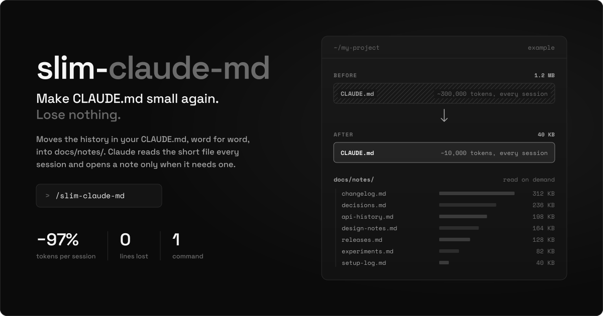
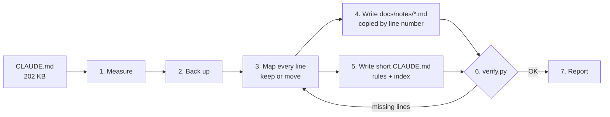

<p align="center">
  
</p>

<p align="center">
  <a href="LICENSE"></a>
  
  
  
  
</p>

<h4 align="center">Your CLAUDE.md is read in full at the start of every session. Most of it is history you rarely need.</h4>

<p align="center">
  <a href="#quick-start">Quick Start</a> •
  <a href="#how-it-works">How It Works</a> •
  <a href="#what-stays-and-what-moves">What Stays</a> •
  <a href="#the-safety-check">Safety Check</a> •
  <a href="#faq">FAQ</a> •
  <a href="#license">License</a>
</p>

---

## The problem

On a long project, `CLAUDE.md` turns into a diary: dated status notes,
decisions that are already built, previews that were rejected, fixes from
three months ago. Claude Code loads **all of it into every session**, before
you type a word. You pay for that context on every turn, and the instructions
that matter get buried in it.

**slim-claude-md** moves that history out, word for word, into topic files
under `docs/notes/`. What stays is a short `CLAUDE.md` with the rules you need
every time plus an index that tells Claude which notes file to read when it
works on that topic. A line-by-line check proves nothing was lost.

## Real result

From the project this skill was built on:

| | Before | After |
|---|---|---|
| `CLAUDE.md` | 202 KB | **14 KB** |
| Tokens loaded every session | ~50,000 | **~3,600** |
| Lines lost | | **0** (checked by `verify.py`) |
| Where the history went | | 7 topic files in `docs/notes/` |

Nothing about how you work changes. Claude still has every note; it just reads
the one it needs, when it needs it.

## Quick Start

**Option 1: ask Claude Code**

```
Install the skill from https://github.com/hustle-x/slim-claude-md
```

**Option 2: by hand**

```bash
git clone https://github.com/hustle-x/slim-claude-md.git
cp -r slim-claude-md/slim-claude-md ~/.claude/skills/
```

Project-only instead of global: copy the folder into your repo's
`.claude/skills/`.

**Then, inside a project:**

```
slim my CLAUDE.md
```

or run `/slim-claude-md`.

## How it works



1. **Measure.** Under ~25 KB it tells you the file is already fine and stops.
2. **Back up** the original before anything is written.
3. **Map** every line by number and sort it into *keep* or *move*, grouped by topic.
4. **Write the notes**, one file per topic, copied by line number with a script,
   never retyped.
5. **Write the short `CLAUDE.md`**: kept lines in their original order, a
   current status line, and a `## Notes` index.
6. **Verify** with `verify.py`. If any line is missing, it goes back and fixes it.
7. **Report** old size, new size, tokens saved, the notes files and the backup.

## What stays and what moves

| Stays in `CLAUDE.md` | Moves to `docs/notes/<topic>.md` |
|---|---|
| What the project is, in a few lines | Dated status logs and changelogs |
| Current status (2-3 lines) | Decisions that are already built |
| Build, run, test, install, release, deploy | Previews, experiments, rejected ideas |
| Secrets and account rules | Old versions and their quirks |
| Rules for working with you | Long per-feature write-ups |
| Tool rules (linters, graph tools, etc.) | |
| An index of the notes files | |

When in doubt, it keeps the line. The index also tells Claude to add **new**
notes to the matching notes file, so `CLAUDE.md` stays small afterwards.

## The safety check

`verify.py` compares the backup with the new files. Every non-empty line of
the original must appear in the new set **at least as many times as before**.

```bash
python3 slim-claude-md/verify.py CLAUDE.before.md CLAUDE.md docs/notes/*.md
```

```
CLAUDE.md: 202,239 bytes -> 14,461 bytes (about 46,944 tokens saved per session)
OK: all 247 non-empty lines are kept.
```

If anything went missing it prints the lines and exits with code 1.

- Standard-library Python 3.8+. Nothing to install.
- Never touches the network.
- Reads only the files you pass it.

## Rules the skill follows

- Never deletes, summarises or rewords moved text.
- Never touches code, settings or any file other than `CLAUDE.md` and `docs/notes/`.
- Always keeps a backup of the original.
- Does not finish until `verify.py` prints `OK`.

## FAQ

**Will Claude forget things?**
No. Every line is still in the repo. The index in `CLAUDE.md` names each notes
file and what is in it, and tells Claude to read the matching one before
working on that topic.

**Why not just summarise the old notes?**
Summaries lose details: a file name, a flag, the reason a fix was made. Moving
text word for word keeps them, and `verify.py` can prove it.

**How many tokens does this save?**
Roughly 1 token per 4 bytes removed from `CLAUDE.md`, on every session start.
The report prints the estimate for your file.

**My CLAUDE.md is small. Do I need this?**
No. Under ~25 KB the skill says so and stops.

**Can I undo it?**
Yes. Restore the backup it made, or use git.

**Does it work without Claude Code?**
The method is plain Markdown and `verify.py` is a standalone script, so you
can follow the steps in `SKILL.md` by hand with any agent.

## Repository layout

```
slim-claude-md/
├── SKILL.md      the steps Claude follows
└── verify.py     the line-by-line check
docs/             README banners
```

## License

[MIT](LICENSE)
